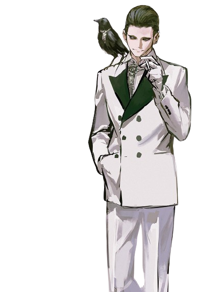

<!---
<h1 align="center">Hi there I'm John </h1>
<p align="right">
    
</p>

--->


</div>


<body>
<br>
<div align="center">

</div>
<br>

<h2 align="center">  About me 🧑‍💻 </h2>

```zsh
> Ferrari
```




```csharp
My Profile
-------------------------------
Username: Wel
WhoamI: I'm currently studying programming at Unifil Londrina, my goal is complete the graduation of Software Engineering. Right now, I'm busy learning as many programming languages as I can to prepare for my future studies and career.
Location: 🇧🇷/🇨🇦
Languages: C, C++, Python, JS, Node, Lua, Java, HTML
Learning: Cheat Engine, HTML
Hobbies: Gaming, reading manga and coding

```
<p align = "center">
    <a href="https://skillicons.dev">
         
    </a>
</p>
</div>
<br>
<br>
<br>
<br>
<br>
<br>

<h2 align = "center"> 📉 GitHub Stats</h2>
<div> 
<p align = "center">
    <a href="https://github-readme-stats.vercel.app">
        
    </a>
    <a href="https://github-readme-streak-stats.herokuapp.com">
        
    </a><!--change language to japanese locale=jp-->
    <a href="https://github.com/ryo-ma/github-profile-trophy">
        
        
    </a>
    <a href="https://github.com/ashutosh00710/github-readme-activity-graph">
        
    </a>
    <a href="https://github.com/vn7n24fzkq/github-profile-summary-cards">
        
</div>
<br>
<br>


<br>

<h2 align ="center"> 📝 Contact me 📝</h2>
<br> 
<div align="center">
<a href="https://github.com/WlFerrari" target="_blank">

</div> 
